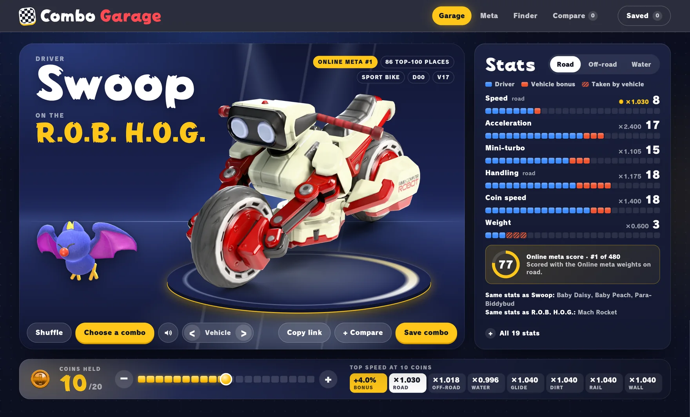
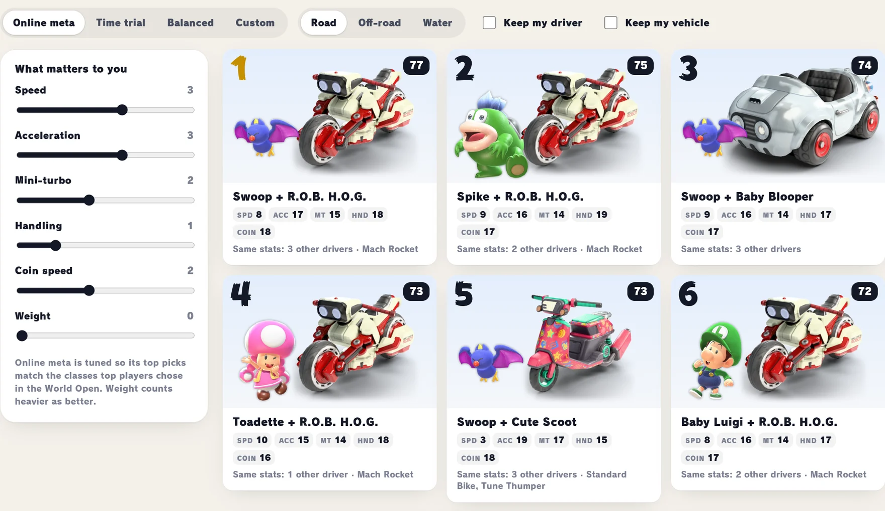

<div align="center">


<h1>Combo Garage</h1>

<p><strong>Find your next main.</strong><br>
The Mario Kart World combo builder for the way you race.</p>

<p>
  <a href="https://combogarage.pages.dev/"><strong>Open the garage →</strong></a>
  &nbsp; · &nbsp;
  <a href="docs/how-it-works.md">How it works</a>
  &nbsp; · &nbsp;
  <a href="#run-locally">Run locally</a>
</p>

<p><strong>50 drivers</strong> &nbsp; / &nbsp; <strong>153 looks</strong> &nbsp; / &nbsp; <strong>40 vehicles</strong> &nbsp; / &nbsp; <strong>480 distinct stat builds</strong></p>

</div>

[](https://combogarage.pages.dev/?d=Driver_Basabasa_00&v=Vehicle_Hvc_00&c=10)

Pick your favourite driver. Find their perfect ride. See exactly what changes before you hit the track.

Combo Garage puts the whole roster in a visual workshop, with path-traced vehicle renders, live stats and the tools to turn “this looks fun” into your next go-to build. **Open it in your browser and start building. No account required.**

## Your driver. Your ride. Your edge.

| In the garage | What you can do |
| :--- | :--- |
| **Build your combo** | Browse every driver, outfit, kart and bike. Hover to preview the stat changes, and find other characters or vehicles with the same stats. |
| **Read the whole picture** | Switch between road, off-road and water. See what your driver contributes, what your vehicle adds or takes away, and the multipliers behind all 19 stats. |
| **Make every coin count** | Move from 0 to 20 coins and watch top speed change across seven surfaces, including gliding, rails and walls. |
| **Find your fit** | Start with Online meta, Time trial or Balanced weights, then tune the stats you care about. Keep your favourite driver or vehicle locked in. |
| **Settle the shortlist** | Compare up to three combos side by side, including how their top speeds change as you collect coins. |
| **Keep the good ones** | Save favourites in your browser. Copy a link to share your driver, outfit, vehicle and coin count. |

## Build for the way you race

More acceleration after a hit? Longer mini-turbos? A little more straight-line speed? **Tell the Finder what matters to you.** It ranks the stat builds against your priorities and groups identical options, so you can choose the look you like.

[](https://combogarage.pages.dev/#finder)

The interactive **combo map** lets you explore the trade-offs between any two core stats. The **Meta** section shows what top players actually race with: every driver in the top 100 of four 2026 Mario Kart World Opens, down to the outfit, and the driver and vehicle behind each standing time trial record. Stat ranges, coin curves and builds drawn from those combos sit alongside.

Stats come from the game's own tables. Finder scores reflect the weights you choose; they aren't predicted lap times. [See the maths and sources →](docs/how-it-works.md)

## A garage worth browsing

Every one of the **40 vehicles** has been path-traced in Blender Cycles from the game's highest-detail models and textures, with original renders at **3840 × 2560**. They park on a turntable in the night-time showroom, and all forty drive past on the road at the bottom of the page. Character art, outfits and the game's own typefaces bring the rest of the garage to life.

Feeling lucky? Hit **Shuffle**. Three reels land on a driver, a kart or bike, and your ride, with roulette sounds and a coin burst to finish. Mute is one tap away, and reduced-motion settings are respected.

<p align="center">
  <a href="https://combogarage.pages.dev/"><strong>Find your next combo →</strong></a>
</p>

---

## Run locally

Plain HTML, CSS and JavaScript. No install step, build step or backend. From the repository root, serve the ready-to-run site with Python 3:

```sh
python3 -m http.server 8080 --directory dist
```

Open [localhost:8080](http://localhost:8080). Saved combos stay in the browser where you created them.

- [How it works](docs/how-it-works.md) — stat calculations, coin mechanics, shuffle behaviour and sources.
- [Development](docs/development.md) — project layout, asset pipeline and deployment metadata.

## Credits & license

An unofficial fan project. Mario Kart World and its game data, character art, vehicle and coin models, fonts and sounds belong to Nintendo. This project's own code is available under the [BSD 3-Clause license](LICENSE); Nintendo's assets are not covered by it.
